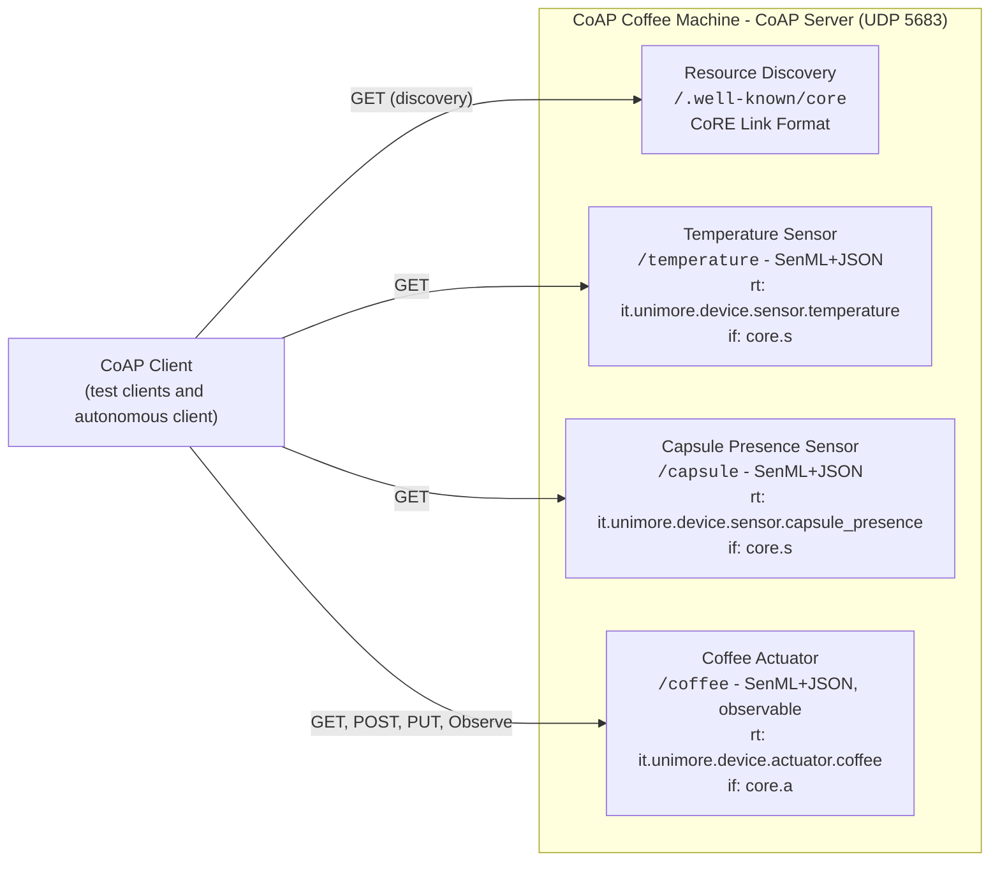
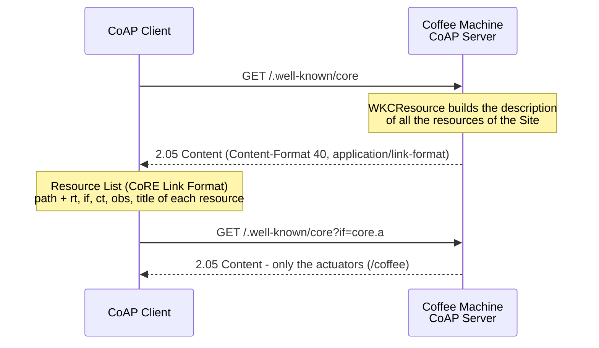
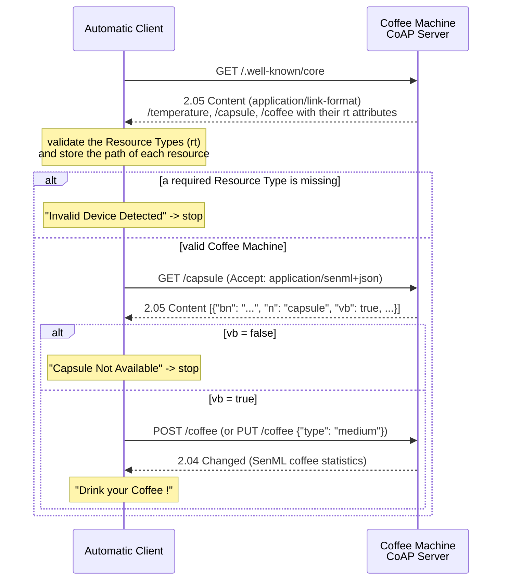

# Python - Laboratory CoAP Interoperability

This project is associated to the CoAP Interoperability Laboratory. It is an **extension of the CoAP Laboratory**
(`laboratory-python-coap`) and starts from its solution, the CoAP **Coffee Machine**, to make the device interoperable,
i.e., discoverable and usable by a client that does not know it in advance:

- all the resources describe themselves through the **CoRE Link Format** (RFC 6690), according to their nature
  (sensor or actuator);
- all the resources return their representations in the **SenML+JSON** format (RFC 8428);
- the CoAP Server exposes the list of its resources supporting the **CoAP Resource Discovery** through the standard
  URI `/.well-known/core`;
- an **autonomous client** discovers the resources, validates their Resource Types, checks the presence of the capsule
  and makes a coffee, without any hardcoded path.

Reference CoAP Python Library aiocoap (0.4.x) - https://github.com/chrysn/aiocoap

The project is self-contained: it already includes the complete code of the CoAP Laboratory with the changes
described in this document. For all the basic information about the modeling of the resources before these changes
(model classes, DTO, GET/POST/PUT handling and Observe), refer to the README of the CoAP Laboratory.

## Setup

The project is managed with [uv](https://docs.astral.sh/uv/). Dependencies are declared in `pyproject.toml`,
locked in `uv.lock`, and the Python version (3.12) is pinned in `.python-version`.

- Dependencies:
  - `aiocoap` (0.4.x): CoAP library based on `asyncio`
  - `LinkHeader`: parsing of the CoRE Link Format (used by aiocoap for `/.well-known/core` and by the clients)
  - `kpn-senml`: creation of the SenML payloads
  - `cbor2`: CBOR encoding and decoding (required by `kpn-senml`)
  - `pyyaml`: to read the configuration file

Install uv (if needed) following the [official instructions](https://docs.astral.sh/uv/getting-started/installation/), e.g.:

```bash
curl -LsSf https://astral.sh/uv/install.sh | sh
```

Then, from the project root, create the virtual environment (`.venv`) and install all the dependencies with:

```bash
uv sync
```

uv automatically downloads the required Python version if it is not available on your machine.
The command also installs the `coap_interoperability_laboratory` package (in `src/`) in editable mode, together with
a dedicated command for the server and for each client (see [Running the Laboratory](#running-the-laboratory)).

In PyCharm, you can select the existing `.venv` interpreter or add a new "uv" interpreter from the interpreter settings.

### Using pip (alternative)

The `requirements.txt` file is **generated** from `uv.lock` and is kept only for pip-based workflows:

```bash
pip install -r requirements.txt
```

Do not edit it manually. After changing the dependencies, regenerate it with:

```bash
uv export --no-hashes --no-dev -o requirements.txt
```

### CoAP Server

As in the CoAP Laboratory, the Coffee Machine is a **CoAP Server** running on your machine and listening on the
default CoAP port `5683` over **UDP**. Only one process at a time can listen on the same port: stop the Coffee Machine
of the CoAP Laboratory (or any other CoAP server) before starting this one, or change the port in `config.yaml`.

## Specifications


*Figure 1: The CoAP Coffee Machine with its sensors, its actuator and the Resource Discovery.*

The Coffee Machine exposes the same resources and methods of the CoAP Laboratory. The changes introduced by this
laboratory are summarized in the following table:

| Aspect                     | CoAP Laboratory                         | CoAP Interoperability Laboratory                                                   |
|----------------------------|-----------------------------------------|------------------------------------------------------------------------------------|
| Representation of the GET  | JSON (`application/json`, `50`)         | SenML JSON (`application/senml+json`, `110`)                                       |
| Accept option              | Ignored                                 | `application/senml+json` or none, otherwise `4.06 Not Acceptable`                  |
| Response of POST and PUT   | `2.04 Changed` + JSON statistics        | `2.04 Changed` + SenML JSON statistics                                             |
| PUT request payload        | `{"type": "long"}` (JSON)               | Unchanged                                                                          |
| Resource description       | None                                    | CoRE Link Format attributes (`rt`, `if`, `ct`, `obs`, `title`)                     |
| Resource Discovery         | Not supported (`4.04 Not Found`)        | `GET /.well-known/core`                                                            |
| Device identity            | None                                    | `device.name` in `config.yaml`, used as SenML Base Name                            |
| Clients                    | GET, POST, PUT, Observe                 | GET with Accept SenML, POST, PUT, Observe, Discovery and the autonomous client     |

### CoRE Link Format Description


*Figure 2: Support for the CoAP Resource Discovery through the CoRE Link Format and the standard URI `/.well-known/core`.*

Each resource describes itself with the following CoRE Link Format attributes:

| Resource       | `rt` (Resource Type)                        | `if` (Interface)   | `ct`  | `obs` | `title`                   |
|----------------|---------------------------------------------|--------------------|-------|-------|---------------------------|
| `/temperature` | `it.unimore.device.sensor.temperature`      | `core.s` (sensor)  | `110` | -     | `Temperature Sensor`      |
| `/capsule`     | `it.unimore.device.sensor.capsule_presence` | `core.s` (sensor)  | `110` | -     | `Capsule Presence Sensor` |
| `/coffee`      | `it.unimore.device.actuator.coffee`         | `core.a` (actuator)| `110` | Yes   | `Coffee Actuator`         |

A `GET /.well-known/core` request returns the description of all the resources (Content-Format `40`,
`application/link-format`):

```
</.well-known/core>;ct="40",
</temperature>;ct="110";rt="it.unimore.device.sensor.temperature";if="core.s";title="Temperature Sensor",
</capsule>;ct="110";rt="it.unimore.device.sensor.capsule_presence";if="core.s";title="Capsule Presence Sensor",
</coffee>;ct="110";rt="it.unimore.device.actuator.coffee";if="core.a";obs;title="Coffee Actuator"
```

The list can be filtered with a query on any attribute, e.g., `/.well-known/core?if=core.s` (only the sensors) or
`/.well-known/core?rt=it.unimore.device.actuator.coffee`.

### SenML Representations

All the SenML payloads use the name of the device (`urn:dev:coffee-machine-0001:`) as **Base Name** (`bn`) of the Pack:
the full name of each Record is the concatenation of `bn` and `n` (e.g., `urn:dev:coffee-machine-0001:temperature`),
for this reason the configured name ends with the separator `:`. Times (`t`, `bt`) are Unix times in **seconds**.

Temperature (`GET /temperature`), numeric value `v` with unit `Cel`:

```json
[
    {"bn": "urn:dev:coffee-machine-0001:", "n": "temperature", "v": 91.86, "u": "Cel", "t": 1730000000.44}
]
```

Capsule presence (`GET /capsule`), boolean value `vb`:

```json
[
    {"bn": "urn:dev:coffee-machine-0001:", "n": "capsule", "vb": true, "t": 1730000000.49}
]
```

Coffee statistics (`GET /coffee`, POST and PUT responses, notifications), a Record for each counter with unit `count`
and a Base Time (`bt`) shared by all the Records:

```json
[
    {"bn": "urn:dev:coffee-machine-0001:", "bt": 1730000000, "n": "short_coffee", "v": 1, "u": "count"},
    {"n": "medium_coffee", "v": 2, "u": "count"},
    {"n": "long_coffee", "v": 1, "u": "count"},
    {"n": "total_coffee", "v": 4, "u": "count"}
]
```

### Autonomous Client

The autonomous client interacts with the Coffee Machine knowing only its address and the Resource Types it requires:

1. **Resource Discovery**: `GET /.well-known/core`;
2. **validation of the Resource Types**: the device is valid only if it exposes all the required Resource Types
   (temperature sensor, capsule presence sensor and coffee actuator). The path of each resource is stored to be used
   in the next steps without other discovery requests;
3. **capsule check**: `GET` on the path of the capsule sensor, reading the boolean value of the `capsule` Record;
4. **coffee request**: `POST` on the path of the coffee actuator (default coffee) or `PUT` with the requested type.



Since the capsule presence is emulated with a random value, run the client more than once to see both the
successful flow and the `Capsule Not Available` case.

## Configuration

The parameters shared by the server and the clients are defined in the `config.yaml` file in the project root.
With respect to the CoAP Laboratory, the file contains the name of the device:

```yaml
server:
  bind_host: 127.0.0.1
  port: 5683

# Identity of the Coffee Machine, used as SenML Base Name (bn) of all the SenML payloads
device:
  name: "urn:dev:coffee-machine-0001:"

client:
  server_host: 127.0.0.1
  server_port: 5683
```

The `ConfigManager` class (`src/coap_interoperability_laboratory/config/config_manager.py`) exposes the new
`device_name` property, besides `server_bind_host`, `server_port`, `client_server_host`, `client_server_port` and
`build_server_uri(path)`.

## Project Structure

The project follows the `src` layout: all the code is in the `coap_interoperability_laboratory` package in `src/`.

```
laboratory-python-coap-interoperability/
├── pyproject.toml                          # Project metadata, dependencies and entry points
├── uv.lock                                 # Locked dependency versions (managed by uv)
├── requirements.txt                        # Generated from uv.lock for pip users
├── config.yaml                             # Shared configuration (server, device name and clients)
├── src/coap_interoperability_laboratory/   # Application package
│   ├── config/                             # ConfigManager (reads config.yaml)
│   ├── model/                              # TemperatureSensor, CapsulePresenceSensor, CoffeeHistory (unchanged)
│   ├── dto/                                # MakeCoffeeRequest (unchanged)
│   ├── resources/                          # CoAP resources with CoRE Link Format attributes and SenML payloads
│   ├── process/                            # Coffee Machine CoAP Server with /.well-known/core
│   └── client/                             # Test clients, Discovery client and the autonomous client
```

The `model` and `dto` packages are the same of the CoAP Laboratory: the interoperability changes affect only the
way the resources describe and represent themselves (`resources/`), the server (`process/`) and the clients (`client/`).

Type hints are not checked at runtime by Python. To check the code with [mypy](https://mypy.readthedocs.io/) run:

```bash
uv run --with mypy mypy src/coap_interoperability_laboratory --ignore-missing-imports
```

---

## Tutorial

The following steps describe the changes applied to the code of the CoAP Laboratory. The complete code is available
in `src/coap_interoperability_laboratory`.

### 1. Device Name in the Configuration

Add the `device.name` parameter to `config.yaml` and the corresponding property to the `ConfigManager`:

```python
DEFAULT_DEVICE_NAME = "urn:dev:coffee-machine-0001:"

@property
def device_name(self) -> str:
    """ Name of the Coffee Machine, used as SenML Base Name (bn) by all the resources """
    return str(self.get("device.name", self.DEFAULT_DEVICE_NAME))
```

### 2. Resource Utilities

All the resources return SenML JSON and check the Accept option of the GET requests in the same way. The common code
is collected in the file `resources/resource_utils.py`:

```python
import aiocoap
from aiocoap.numbers import ContentFormat

# Content-Format of the representations of all the resources: application/senml+json (110)
SENML_JSON_CONTENT_FORMAT = ContentFormat.by_media_type("application/senml+json")


def is_senml_json_accepted(request: aiocoap.Message) -> bool:
    return request.opt.accept is None or request.opt.accept == SENML_JSON_CONTENT_FORMAT


def build_senml_json_response(payload_string: str, code: aiocoap.numbers.codes.Code = aiocoap.CONTENT) -> aiocoap.Message:
    return aiocoap.Message(code=code, content_format=SENML_JSON_CONTENT_FORMAT, payload=payload_string.encode("utf-8"))


def build_not_acceptable_response() -> aiocoap.Message:
    return aiocoap.Message(code=aiocoap.NOT_ACCEPTABLE)
```

### 3. Update - Temperature CoAP Resource

Modify the first part of the `TemperatureSensorResource` class: the constructor receives the `device_name` and
describes the resource through its attributes. aiocoap reads the fields `if_`, `ct` and `rt` of each resource to build
the CoRE Link Format description (`if_` is used since `if` is a Python keyword), while the `title` is added by
overriding `get_link_description()`:

```python
class TemperatureSensorResource(resource.Resource):

    # Resource Type of the Temperature Sensor (application specific semantic type)
    RESOURCE_TYPE = "it.unimore.device.sensor.temperature"

    def __init__(self, device_name: str) -> None:
        super().__init__()

        # CoRE Link Format attributes used by aiocoap to build the /.well-known/core description
        self.if_ = "core.s"                             # Interface Description: CoRE Interfaces - Sensor
        self.ct = int(SENML_JSON_CONTENT_FORMAT)        # Content-Format of the representation (110)
        self.rt = self.RESOURCE_TYPE                    # Resource Type
        self.title = "Temperature Sensor"               # Human readable title

        self.device_name = device_name
        self.temperature_sensor = TemperatureSensor()

    def get_link_description(self) -> dict[str, Any]:
        """ Extend the default link description (ct, rt, if) with the title attribute """
        link = super().get_link_description()
        link["title"] = self.title
        return link
```

Add the following method to build the SenML JSON payload with the `kpn-senml` library. The name of the device is the
name of the Pack (i.e., the Base Name of the first Record), while the timestamp of the model, in milliseconds, is
converted to seconds:

```python
def build_senml_json_payload(self) -> str:
    pack = SenmlPack(self.device_name)
    pack.add(SenmlRecord("temperature",
                         unit=SenmlUnits.SENML_UNIT_DEGREES_CELSIUS,
                         value=self.temperature_sensor.value,
                         time=self.temperature_sensor.timestamp / 1000))   # SenML time is in seconds
    return pack.to_json()
```

Modify the `render_get()` method to check the Accept option and return the SenML JSON representation:

```python
async def render_get(self, request: aiocoap.Message) -> aiocoap.Message:

    if not is_senml_json_accepted(request):
        return build_not_acceptable_response()

    self.temperature_sensor.measure_temperature()

    return build_senml_json_response(self.build_senml_json_payload())
```

### 4. Update - Capsule Presence CoAP Resource

Apply the same changes to the `CapsulePresenceSensorResource` class, with `rt = "it.unimore.device.sensor.capsule_presence"`,
`if_ = "core.s"` and `title = "Capsule Presence Sensor"`. The SenML Record contains a boolean value, serialized by
`kpn-senml` in the `vb` field:

```python
def build_senml_json_payload(self) -> str:
    pack = SenmlPack(self.device_name)
    pack.add(SenmlRecord("capsule",
                         value=self.sensor.value,
                         time=self.sensor.timestamp / 1000))
    return pack.to_json()
```

### 5. Update - Coffee Actuator CoAP Resource

Apply the same changes to the `CoffeeActuatorResource` class, with `rt = "it.unimore.device.actuator.coffee"`,
`if_ = "core.a"` (actuator) and `title = "Coffee Actuator"`. Since the class extends `ObservableResource`, aiocoap
automatically adds the `obs` attribute to its description.

The SenML payload contains a Record for each counter of the `CoffeeHistory`, with the unit `count`, and a Base Time
shared by all the Records:

```python
def build_senml_json_payload(self) -> str:

    pack = SenmlPack(self.device_name)

    # Base Time (bt): all the Records refer to the current time
    pack.base_time = int(time.time())

    pack.add(SenmlRecord("short_coffee", unit=SenmlUnits.SENML_UNIT_COUNTER, value=self.coffee_history.shortCount))
    pack.add(SenmlRecord("medium_coffee", unit=SenmlUnits.SENML_UNIT_COUNTER, value=self.coffee_history.mediumCount))
    pack.add(SenmlRecord("long_coffee", unit=SenmlUnits.SENML_UNIT_COUNTER, value=self.coffee_history.longCount))
    pack.add(SenmlRecord("total_coffee", unit=SenmlUnits.SENML_UNIT_COUNTER, value=self.coffee_history.totalCount))

    return pack.to_json()
```

> `kpn-senml` 1.0.1 supports the Base Time (`base_time`), Base Value and Base Sum on the Pack, but not the Base Unit:
> the unit is therefore set on each Record.

`render_get()` checks the Accept option as the other resources, while the response of POST and PUT (built by
`notify_new_coffee()`) contains the updated statistics in SenML JSON:

```python
def notify_new_coffee(self) -> aiocoap.Message:
    self.updated_state()
    return build_senml_json_response(self.build_senml_json_payload(), code=aiocoap.CHANGED)
```

The PUT request is unchanged: its payload is still the JSON `MakeCoffeeRequest`, since SenML is used to represent
measurements and parameters, not commands with a custom structure.

### 6. Update - Coffee Machine CoAP Server

Modify the `run_server()` function of `coffee_machine_server.py` to pass the name of the device to each resource and
to register the `/.well-known/core` resource. The `WKCResource` builds the CoRE Link Format description of all the
resources of the `Site`, using the attributes exposed by each resource:

```python
async def run_server(config_manager: ConfigManager) -> None:

    device_name = config_manager.device_name

    root = resource.Site()

    # impl_info=None removes the link to the aiocoap web site that is added by default
    root.add_resource([".well-known", "core"], resource.WKCResource(root.get_resources_as_linkheader, impl_info=None))
    root.add_resource(["temperature"], TemperatureSensorResource(device_name))
    root.add_resource(["capsule"], CapsulePresenceSensorResource(device_name))
    root.add_resource(["coffee"], CoffeeActuatorResource(device_name))

    await aiocoap.Context.create_server_context(root, bind=(config_manager.server_bind_host, config_manager.server_port))
    await asyncio.get_running_loop().create_future()
```

### 7. Updated Test Clients

Starting from the clients of the CoAP Laboratory and from the examples of the CoAP Playground, the `client` package
contains the following test clients:

| Client                 | File                         | Description                                                                         |
|------------------------|------------------------------|-------------------------------------------------------------------------------------|
| CoAP Discovery Client  | `coffee_discovery_client.py` | GET `/.well-known/core` (with an optional query filter) and print each resource     |
| CoAP GET SenML Client  | `coffee_get_client.py`       | GET with `Accept: application/senml+json` and print the SenML Records               |
| CoAP Observe Client    | `coffee_observe_client.py`   | Observe `/coffee` and print the SenML notifications                                 |
| CoAP POST Client       | `coffee_post_client.py`      | POST `/coffee` to make a coffee of the default type                                 |
| CoAP PUT Client        | `coffee_put_client.py`       | PUT `/coffee` with the type passed as argument                                      |

The GET client sets the Accept option to request the SenML JSON representation and parses the payload, that is a
JSON array of Records:

```python
SENML_JSON_CONTENT_FORMAT = ContentFormat.by_media_type("application/senml+json")

request = aiocoap.Message(code=aiocoap.GET, uri=target_uri, accept=SENML_JSON_CONTENT_FORMAT)
response = await context.request(request).response

records = json.loads(response.payload.decode("utf-8"))
for record in records:
    print(record)
```

The Discovery client parses the CoRE Link Format with the `LinkHeader` library:

```python
import link_header

for link in link_header.parse(response.payload.decode("utf-8")).links:
    print(f"Resource: {link.href}")
    for attribute_name, attribute_value in link.attr_pairs:
        print(f"\t{attribute_name}: {attribute_value}")
```

### 8. Autonomous Client

The file `client/coffee_automatic_client.py` contains the autonomous client. The Resource Types required to consider
the device a valid Coffee Machine are defined as configuration variables:

```python
RT_TEMPERATURE_SENSOR = "it.unimore.device.sensor.temperature"
RT_CAPSULE_SENSOR = "it.unimore.device.sensor.capsule_presence"
RT_COFFEE_ACTUATOR = "it.unimore.device.actuator.coffee"
WELL_KNOWN_CORE_PATH = "/.well-known/core"
```

The client is implemented by the `CoffeeMachineAutomaticClient` class: the paths of the discovered resources are
attributes of the object, so each step of the flow can use the results of the previous ones.

```python
class CoffeeMachineAutomaticClient:

    def __init__(self, config_manager: ConfigManager, coffee_type: str | None) -> None:
        self.config_manager = config_manager
        self.coffee_type = coffee_type

        # Paths of the resources found with the Resource Discovery (None until they are discovered)
        self.temperature_sensor_path: str | None = None
        self.capsule_sensor_path: str | None = None
        self.coffee_actuator_path: str | None = None
```

The `is_device_valid()` method parses the CoRE Link Format, looks for the `rt` attribute of each link and stores the
path of the resources with the required Resource Types. The device is valid only if **all** the paths have been found:

```python
def is_device_valid(self, core_link_format: str) -> bool:

    for link in link_header.parse(core_link_format).links:
        for attribute_name, attribute_value in link.attr_pairs:
            if attribute_name != "rt":
                continue
            if attribute_value == RT_TEMPERATURE_SENSOR:
                self.temperature_sensor_path = link.href
            elif attribute_value == RT_CAPSULE_SENSOR:
                self.capsule_sensor_path = link.href
            elif attribute_value == RT_COFFEE_ACTUATOR:
                self.coffee_actuator_path = link.href

    return (self.temperature_sensor_path is not None
            and self.capsule_sensor_path is not None
            and self.coffee_actuator_path is not None)
```

The `is_coffee_capsule_available()` method reads the capsule sensor and looks for the `capsule` Record by name
(so the client does not depend on the order of the Records in the Pack), returning its boolean value `vb`:

```python
def find_senml_record(records: list[dict[str, Any]], name: str) -> dict[str, Any] | None:
    for record in records:
        if record.get("n") == name:
            return record
    return None


async def is_coffee_capsule_available(self, context: aiocoap.Context, capsule_sensor_path: str) -> bool:

    request = aiocoap.Message(code=aiocoap.GET,
                              uri=self.config_manager.build_server_uri(capsule_sensor_path),
                              accept=SENML_JSON_CONTENT_FORMAT)
    response = await context.request(request).response

    if not response.code.is_successful():
        return False

    records = json.loads(response.payload.decode("utf-8"))
    capsule_record = find_senml_record(records, "capsule")

    return capsule_record is not None and capsule_record.get("vb") is True
```

The `make_coffee()` method sends a POST request (default coffee) or, if a coffee type has been passed as argument,
a PUT request with the `MakeCoffeeRequest` payload, and returns `True` if the response code is successful.
Finally, the `run()` method executes the complete flow:

```python
async def run(self) -> None:

    context = await aiocoap.Context.create_client_context()

    try:
        core_link_format = await self.discover_resources(context)

        if not self.is_device_valid(core_link_format) \
                or self.capsule_sensor_path is None or self.coffee_actuator_path is None:
            print("Error: Invalid Device Detected !")
            return

        print("Valid Target Device Detected !")

        if not await self.is_coffee_capsule_available(context, self.capsule_sensor_path):
            print("Capsule Not Available ! Stopping ...")
            return

        print("Capsule Available !")

        if await self.make_coffee(context, self.coffee_actuator_path):
            print("Drink your Coffee ! :)")
        else:
            print("Error making Coffee ! Please try later ...")

    except Exception as e:
        print(f"Error communicating with the Coffee Machine: {e}")
    finally:
        await context.shutdown()
```

The paths are checked against `None` again in `run()` so that the type checker (mypy) knows that they are strings
when they are passed to the next methods.

The suggestion is to test each step and method individually and only at the end the complete flow.

## Running the Laboratory

Each process is exposed as a command declared in the `[project.scripts]` section of `pyproject.toml`:

| Command                   | Module                                                            |
|---------------------------|-------------------------------------------------------------------|
| `coffee-machine-server`   | `coap_interoperability_laboratory.process.coffee_machine_server`  |
| `coffee-discovery-client` | `coap_interoperability_laboratory.client.coffee_discovery_client` |
| `coffee-get-client`       | `coap_interoperability_laboratory.client.coffee_get_client`       |
| `coffee-observe-client`   | `coap_interoperability_laboratory.client.coffee_observe_client`   |
| `coffee-post-client`      | `coap_interoperability_laboratory.client.coffee_post_client`      |
| `coffee-put-client`       | `coap_interoperability_laboratory.client.coffee_put_client`       |
| `coffee-automatic-client` | `coap_interoperability_laboratory.client.coffee_automatic_client` |

From the project root, start the Coffee Machine in a terminal:

```bash
uv run coffee-machine-server
```

In another terminal, test the Resource Discovery and the SenML representations:

```bash
uv run coffee-discovery-client
uv run coffee-discovery-client if=core.s
uv run coffee-get-client temperature
uv run coffee-get-client capsule
uv run coffee-get-client coffee
```

Then run the autonomous client, with the default coffee (POST) or with a specific type (PUT):

```bash
uv run coffee-automatic-client
uv run coffee-automatic-client long
```

The Observe, POST and PUT clients work as in the CoAP Laboratory (`uv run coffee-observe-client`,
`uv run coffee-post-client`, `uv run coffee-put-client long`), but the statistics are now represented in SenML JSON.

Alternatively, you can run a process as a module or execute the file directly:

```bash
uv run python -m coap_interoperability_laboratory.process.coffee_machine_server
uv run src/coap_interoperability_laboratory/process/coffee_machine_server.py
```

The `aiocoap-client` command line tool, installed with aiocoap, can be used to verify the Content Format Negotiation:

```bash
# SenML JSON: 2.05 Content
uv run aiocoap-client --accept application/senml+json coap://127.0.0.1/temperature

# JSON is no longer supported: 4.06 Not Acceptable
uv run aiocoap-client --accept application/json coap://127.0.0.1/temperature
```

To verify the interoperability, try also the autonomous client against a device that is not a Coffee Machine, e.g.,
the Smart Object of the CoAP Playground (`uv run smart-object-server` in the `python-coap-playground` project): the
client discovers its resources but stops with `Invalid Device Detected` since the required Resource Types are missing.
